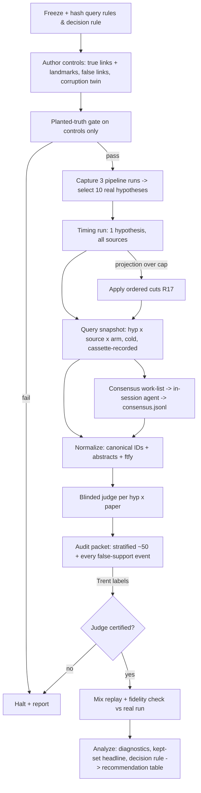

# feat: Literature-source comparison spike for discovery-pipeline grounding

**Target repo:** trentleslie/kraken-chatbot (branch `study/lit-source-comparison`). KRAKEN is the knowledge graph; this concerns the KRAKEN chatbot's discovery pipeline, specifically its `literature_grounding` node.

## Overview

A one-time research spike that decides which literature sources the discovery pipeline should keep, add, re-query, reweight or drop, and whether a certified link-evidence filter should screen the papers users see. It builds a standalone harness under `backend/src/kestrel_backend/evals/lit_sources/`. That harness:
- captures real pipeline hypotheses;
- queries each source in two arms (as-deployed and native query);
- normalizes papers to canonical IDs and abstracts;
- judges each paper for evidence on the specific link (blinded LLM judge, certified by Trent's audit);
- replays the production merge to measure what users actually see.

Production code is not changed.

## Problem Frame

On dev run `cdf9fa68`, all 30 kept papers came from OpenAlex and Exa; KG, PubMed and S2 contributed nothing. Nobody has measured whether the kept papers are evidence for the hypotheses. The fix-first gate (G0) was lifted on 2026-11-11 (Trent): the spike runs now, S2 is reported unavailable until its new key arrives, and Consensus joins through the claude.ai connector (see origin).

Research surfaced three facts that shape the design:
1. **No stored real hypotheses.** Postgres keeps only the synthesis markdown, and Langfuse only counts. Real hypotheses must be captured by running the pipeline (`assessment.capture` / `graph/runner.run_discovery`), which persists full state.
2. **KG short-circuits the other sources.** In `literature_grounding.run()`, if `ground_hypothesis_kg` returns any PMID, `parallel_search_hypothesis` is skipped for that hypothesis. KG PMIDs are attached per entity, not per link, at relevance 1.0.
3. **The merge ranks on relevance scores that aren't comparable across sources.** `merge_literature` sorts on each source's raw `relevance_score` and keeps the top `papers_per_hypothesis = 3`:
   - KG: 1.0
   - OpenAlex: 0.9 − 0.03·rank
   - PubMed: 0.88 − 0.03·rank
   - Exa: native score
   - S2: Jaccard-based, low

   S2 therefore structurally loses the kept set even when it works. The headline "what users see" numbers must reproduce both effects.

## Requirements Trace

Carried from origin (`R` numbers as in the requirements doc):
- R1-R3 (hit definition, blinded judge, audit certification) → Units 5, 7
- R2a (abstract and ID normalization) → Unit 3
- R4-R6a (real hypotheses, true and false controls, pinned Hypothesis objects) → Unit 4
- R7, R7a (sources and tiers, error-transparent calls, verified PubMed client) → Units 1, 2, 6
- R8-R10 (two arms, top-5) → Units 2, 6
- R10a, R10b (end-to-end kept set, judge-as-filter) → Unit 7
- R11, R13 (diagnostics, licensing gate) → Units 2, 8
- R14, R15 (persist by default, pinned inputs, resumable, no 5xx caching) → Unit 1
- R16 (pre-registered decision rule) → Unit 4 (frozen) and Unit 8 (applied)
- R17 (budget cap $25 plus about 1 h audit, ordered cuts) → Compute budget section, Unit 9
- G0 (lifted) → recorded in manifest; S2 reported unavailable until the key works

## Scope Boundaries

- No change to `backend/src/kestrel_backend/graph/nodes/literature_grounding.py` or any production client. The harness may import production functions (`build_search_query`, `merge_literature`, `extract_hypotheses`) but never patches them.
- Not a reusable benchmark: no CI job, no cron, no Inspect solver.
- Title and abstract judging only; no full text.
- Hit/not-hit plus direction; no graded relevance.

### Deferred to Separate Tasks

- Fixing PubMed `raw=0` (#126) in the production client: separate PR. This spike diagnoses it.
- Exponential backoff for S2 on 429: separate PR, to be shipped before the new S2 key is used (it is promised on the key request form).
- KG zero-yield root cause in `direct_kg` (`edge[5]` PMID extraction, cold_start routing): this spike reports the evidence; the fix is a separate PR.
- Implementing any recommended source-mix, query or filter change in production: separate PR(s).
- Per-source health logging in production: recommended follow-up.

## Context & Research

### Relevant Code and Patterns

- `backend/src/kestrel_backend/evals/biomapper_resolution/run_eval.py`: the eval pattern to mirror. Pure `evaluate()` with injectable functions, plus `summarize()`, `build_artifact()`, `default_artifact_path(ts)`. It always writes an artifact; `--out` only overrides the path. `reproduce_inputs` pins versions and SHAs. Tests: `backend/tests/test_biomapper_eval.py` (injected fakes, no HTTP).
- `backend/src/kestrel_backend/assessment/capture.py` + `graph/runner.py:run_discovery`: run the pipeline and persist full serialized state (hypotheses, `resolved_entities`, `study_context`). Example output: `backend/assessment_data/assessment_runs/assessment_20260618T*.json`.
- `backend/src/kestrel_backend/assessment/cassette.py` (`CassetteRecorder`, respx transport intercept): records raw request/response pairs for all five production clients. It is the way to get HTTP status codes while still calling production clients unchanged (R7a).
- `backend/src/kestrel_backend/graph/nodes/hypothesis_extraction.py:extract_hypotheses` (sync; title templates "Inferred role of …", "Bridge: …", "Inferred: A -> B").
- `backend/src/kestrel_backend/graph/nodes/literature_grounding.py`:
  - `build_search_query`, `parallel_search_hypothesis`, `merge_literature`, `ground_hypothesis_kg`, `collect_pmids_from_state`, `backfill_abstracts`, `run`;
  - `SOURCE_PRIORITY`;
  - `LiteratureGroundingConfig` in `graph/pipeline_config.py` (`papers_per_hypothesis = 3`, `parallel_fetch_limit = 6`, `max_hypotheses = 15`).
- Per-source query reality: see the table in the repo research. OpenAlex truncates to 200 chars, PubMed receives the natural-language sentence as an ESearch term, and S2 runs three strategies.
- Clients that swallow errors into `[]`: `openalex.search_works` (all), `semantic_scholar.search_papers` (all but 429), `exa_client.search_papers` (no key or non-HTTP errors), `pubmed_client._esearch` / `_esummary` (generic exceptions).
- Standalone `literature_grounding.run()` works (uncommitted spike `tmp/spike_litground.py`). `load_dotenv()` must run **before** imports, because `EXA_API_KEY` and `S2_API_KEY` are read at import time.
- Tests: pytest `asyncio_mode = auto`, `respx` available, `ftfy` already a dependency. Run with `python -m pytest` (the venv path contains spaces).

### Institutional Learnings

- `docs/solutions/best-practices/reliable-long-running-llm-batch-runs-2026-06-07.md`:
  - one shared transient-exception tuple;
  - retry, then raise, and never record a timeout as a negative;
  - per-item JSONL checkpoints;
  - cost counted as a per-unit delta.
- Vault `docs/solutions/best-practices/absent-evidence-is-unverifiable-not-wrong-2026-08-06.md`: three cell states `ok` / `empty` / `lookup_failed`, never pooled.
- Memory `project_tier3_determinism_cache_confound`: no on-disk HTTP response cache across arms or repeats; run cold; record cache state in the manifest.
- Memory `project_hajjar_scorer_artifact`: match on every identifier a paper carries, never `keys[0]`.
- Vault `docs/solutions/best-practices/benchmark-gate-changes-to-llm-majority-vote-validation-gates-2026-11-01.md`: a missing judge verdict counts as `not_run` and blocks. Calibrate against the human audit, not against LLM-to-LLM agreement.
- Vault `docs/solutions/best-practices/vacuous-tests-verify-the-mutation-landed-2026-08-04.md`: mutation-check the planted-control detectors.
- Vault `docs/solutions/integration-issues/hand-built-fixture-hid-a-live-production-bug-2026-09-23.md`: test fixtures are captured real payloads, one per source.
- Memories `reference_elicit_api` and `reference_ipv6_cloudflare_broken`:
  - Elicit REST `/api/v2` `POST /search/papers` with a Bearer key from `~/.config/elicit/token`;
  - a browser User-Agent;
  - force IPv4.
- Memory `reference_paperbanana_run_provenance` + vault `expensive-run-artifacts-must-outlive-the-worktree-2026-08-04.md`: write the manifest at start and update it as the run progresses. The output root is outside the repo and worktree.
- `docs/solutions/logic-errors/repair-dont-strip-utf8-mojibake-in-citation-fields-2026-06-01.md`: repair titles and abstracts with `ftfy` before dedup and judging.
- Memory `feedback_spike_sizing`: budget and fan-out are set up front; stop at overruns.

## Key Technical Decisions

- **One snapshot, many views.** Each (hypothesis, source, arm) is queried once, cold, and its raw result persisted. Diagnostics (R11) and all simulated mixes (R10a) are computed from that snapshot. Re-querying per mix would make the mixes differ by API drift, not by design.
- **Mixes are replayed with production code, and a fidelity check proves the replay.** A mix replay calls the production `merge_literature` and replicates the KG-first short-circuit over the snapshot. For the current mix, replay output is compared with a real `literature_grounding.run()` on 2 hypotheses executed in the same session. Any difference in kept-set identity outside API drift halts the run. Without this check, "what users see" would be the harness's opinion.
- **Error transparency via cassette, not wrappers.** Production clients run unchanged under `CassetteRecorder`, so each call's HTTP status is classified from the recorded raw response (`ok` / `empty` / `lookup_failed` / `unavailable`). Arm 2 PubMed uses a separate direct E-utilities call, certified against a known query with a known PMID count. Its divergence from the pipeline client is the #126 diagnosis.
- **Consensus runs in-session.** The free-plan connector is callable only from a Claude session. A harness step emits a Consensus work-list (query per hypothesis per arm). A Claude agent runs the connector calls and writes raw results to `sources/consensus.jsonl` in the run directory, with timestamp and query. The harness ingests that file like any other source. Consensus results carry no DOI or PMID, so they resolve by title through OpenAlex, and the unresolved share is reported.
- **Judge = Claude Sonnet 5 via the Agent SDK (local Claude login), blinded to source.** It has no metered API cost. It shares a family with the Opus hypothesis generator; that shared prior is disclosed. Certification comes from Trent's blinded audit, not from the model family. The judge sees only the hypothesis claim, title and normalized abstract.
- **Run directory outside the repo:** `~/kraken-studies/lit-sources/<UTC-ts>/`, local disk, not the Drive-synced checkout. The manifest is written at start and updated per stage; per-item JSONL checkpoints allow resume.
- **Query rules and the decision rule are frozen and hashed (Unit 4) before any control link is authored or any source is queried.** Hashes go in the manifest.
- **Pre-registered decision rule (R16 defaults, adjustable at Checkpoint 2).** 95% confidence intervals are bootstrapped over hypotheses. A difference whose interval includes 0 counts as noise and maps to "keep as-is". Rules:
  - **drop:** contributes 0 judged hits to any kept set across all mixes **and** the upper bound of its per-source precision is below 0.2.
  - **fix query:** Arm 2 precision or yield beats Arm 1, with an interval that excludes 0.
  - **add (Tier 2 / Consensus):** passes the R13 terms-of-service gate **and** adds ≥3 judged unique hits to the kept set **and** does not raise the false-support count.
  - **reweight:** a candidate mix with the same sources but different ranking raises kept-set precision, with an interval that excludes 0.
  - **adopt the judge filter:** raises kept-set precision and lowers false-support, with an interval that excludes 0.
- **Judge certification thresholds:** pooled hit/not-hit agreement ≥ 85% **and** Cohen's κ ≥ 0.6. Per-source agreement is reported; any source below 70% is flagged and its judge-based numbers are excluded.

## Open Questions

### Resolved During Planning

- Where do real hypotheses come from? From 3 fresh capture runs via `assessment.capture` on 3 pre-registered panels with a disease focus:
  - the T2D modules panel (`kraken_test_panel_modules.csv`);
  - the T2D basic panel (`kraken_test_panel_basic.csv`);
  - one non-diabetes free-text query fixed in Unit 4 (for example Alzheimer's).

  Selection rule: the first 4 hypotheses per run in production tier order, deduplicated, capped at 10 (pre-grounding = final hypotheses with `literature_support` stripped).
- Survivorship? None. Research confirmed no stage filters or ranks hypotheses on grounding output (`bridge_grounding` and `synthesis` don't return hypotheses).
- How is KG queried standalone? By `collect_pmids_from_state` + `ground_hypothesis_kg` over the captured run's own state, with no new Kestrel query. KG skips Arm 2 and is excluded from drop/reweight verdicts.
- What is S2's Arm 1? The deployed three-strategy merge, cut to the top 5. S2 is reported `unavailable` while the key is rejected.
- How is precision computed with fewer than 5 results? Hits ÷ returned papers with an abstract; the returned count is reported alongside.

### Deferred to Implementation

- Consensus free-plan daily quota: measured in the timing run; if it binds, Consensus Arm 2 is the first cut.
- Elicit cost per call and terms-of-service answer: checked in Unit 2 before any Elicit scoring (Tier 2).
- Whether OpenAlex title search resolves Consensus papers reliably: the unresolved share is measured. If it exceeds 30%, Consensus unique-hit numbers are flagged as low-confidence.
- Exact Arm 2 query strings follow the frozen rules; the edge-case handling of each rule is settled when building it, before the freeze.

## Output Structure

    backend/src/kestrel_backend/evals/lit_sources/
        __init__.py
        run_study.py          # CLI: stages, manifest, resume
        sources.py            # per-source adapters + call classification
        normalize.py          # canonical IDs, abstracts, ftfy
        hypothesis_set.py     # capture selection, controls loader, query rules
        judge.py              # blinded judge, audit packet, agreement
        mixes.py              # merge replay, fidelity check, judge filter
        analyze.py            # metrics, bootstrap CIs, decision rule
        rules/                # frozen + hashed: query_rules.json, decision_rule.json
        controls/             # true_links.json, false_links.json (authored after the freeze)
    backend/tests/
        test_lit_sources_sources.py
        test_lit_sources_normalize.py
        test_lit_sources_mixes.py
        test_lit_sources_analyze.py
        fixtures/lit_sources/    # one captured real payload per source

## High-Level Technical Design

> *This illustrates the intended approach and is directional guidance for review, not implementation specification. The implementing agent should treat it as context, not code to reproduce.*

## Planted-truth controls

All controls are frozen in Unit 4, before any real hypothesis is queried. They pass through the full path: the same adapters, normalization, judge and matcher as real hypotheses.

| Control | What is planted | Pass criterion | On failure |
|---|---|---|---|
| **P1 Known-true recall** | ~6 established links (e.g., BCAA → insulin resistance; leucine → mTORC1), each with ≥1 landmark registered as a PMID + DOI pair before any query. At least 2 are of moderate obscurity, closer to bridge-style hypotheses. | ≥1 landmark recovered by canonical-ID match in at least one source. **And** every available source that recovers no landmark is investigated before its numbers are used. | Halt: the harness or matcher is broken. |
| **P2 Corruption (entity swap)** | One true link re-issued with both entities swapped for unrelated ones; its original landmark paper is injected into the corrupted hypothesis's paper list. | The judge marks the injected landmark **not-hit** for the corrupted link, and **hit** for the clean twin. | Halt: the judge is matching topic, not link. |
| **P3 False links** | ~4 fabricated plausible links, each verified before the run to have no supporting literature (explicit search across all sources, recorded). | Every judge "supports" verdict is routed to Trent's review (100%); counts reported raw. | Not a halt; it is the measured false-support quantity. |
| **P4 Matcher mutation** | A landmark presented under its DOI only, under its PMID only, and under a mojibake'd title. | All three variants match the registered landmark; a decoy with a one-character DOI change does not. | Halt: the identity layer is miscounting. |
| **P5 Failure-state nulls** | Captured fixtures: S2 403, OpenAlex 500, a timeout, and a genuine empty 200. | They classify as `lookup_failed`, `lookup_failed`, `lookup_failed` and `empty` respectively; none counts as 0 hits. | Halt: failures would masquerade as "nothing found". |
| **P6 Fidelity** | Current-mix replay vs a real `literature_grounding.run()` on 2 captured hypotheses, same session. | Identical kept-set identity, except for papers attributable to API drift between the two calls (logged). | Halt: the headline would measure the harness, not production. |

Each detector gets a "prove it can fail" check (vacuous-test learning): the clean twin of P2 must pass and the decoy in P4 must fail. These run as unit tests and again live in the gate stage.

## Compute budget

- **Timing run first** (Unit 9, stage `timing`): 1 real hypothesis × all available sources × both arms, plus judging of its papers, with a time-stamped log. Rate is fit per stage (source calls, normalization lookups, judge calls). The projection is written to the manifest, with its provenance, before the full run.
- **A priori fan-out (unmeasured guess, to be replaced by the timing run):**
  - Hypotheses: 20 (10 real + 6 true + 4 false).
  - Source calls: about 200 (Tier 1 = 4 sources, with S2 unavailable today; Arm 2 for PubMed and Consensus only; Consensus also in Arm 1).
  - Raw papers: up to ~1,000. After dedup, ~600–800 (hypothesis, paper) judge calls.
  - Capture: 3 pipeline runs.
- **Cost:** judge and capture both run on the local Claude login (no metered spend). Metered spend is limited to Elicit credits (Tier 2 only) and Exa, which is already paid per call on the existing key. Cap: **$25** (R17).
- **Time:** if the projection exceeds **2 hours wall-clock**, restructure before launch, in this order:
  1. drop Tier 2 (Elicit);
  2. drop Consensus Arm 2;
  3. drop Arm 2 for any remaining source whose native form is a sentence;
  4. trim real hypotheses from 10 to 6.

  Bigger machines or more parallelism are not the answer.
- **Trent's time:** about 1 hour, covering the audit packet (~50 judgments) plus every false-support event (≤~20 expected). If the false-support count would push his time over 1.5 hours, the false links are cut from 4 to 3.
- **Progress unit:** judged (hypothesis, paper) rows in `judgments.jsonl`. Monitoring watches that count.

## Independence

| Headline number | Produced by | Certified by | Why they can't fail the same way | Deepest shared layer |
|---|---|---|---|---|
| Kept-set evidence-precision per mix (R10a) | Blinded LLM judge on replayed kept sets | Trent's blinded audit, stratified by source, sample drawn by rule before he sees any verdict | Different reader (human vs LLM). The sample rule is fixed before verdicts exist, so a cherry-picked sample can't hide judge error. | Both read the same normalized abstract. A garbled or missing abstract is a shared failure, mitigated by ftfy repair and by excluding no-abstract papers (counted separately). |
| False-support count (P3, per mix) | LLM judge "supports" on fabricated links | Trent reviews **every** event | Full review, not a sample. | The fabricated links themselves. Mitigated by the pre-run literature check across all sources, recorded. |
| Landmark recall (P1) | Canonical-ID matcher over normalized results | The pre-registered landmark list, written before any query, plus the P4 mutation test | The list cannot have been tuned to the matcher, and the mutation test proves the matcher fails on the decoy. | The NCBI ID converter / OpenAlex used for normalization. Mitigated: landmarks are registered as PMID + DOI pairs, verified at authoring time directly in PubMed. |
| "Current mix" equals production | Harness replay (`merge_literature` + KG-first replica) | P6 fidelity: a real `literature_grounding.run()` | The production entry point vs the harness path. | `merge_literature` itself is shared by design: the claim is "replay = production", not "merge is correct". |
| PubMed diagnosis (client vs query vs corpus) | Pipeline PubMed client (Arm 1) vs direct E-utilities (Arm 2) | A known query with a known PMID count checked on the direct client | Different code paths. Only NCBI itself is shared, and it is the ground truth. | NCBI E-utilities. |

**Oracle contact log:** the landmark list and false-link list are append-only once frozen. Any edit after the first real-hypothesis query is logged in the manifest and invalidates P1 and P3 for that run.

## Implementation Units

- [ ] **Unit 1: Harness skeleton, manifest and persistence**

**Goal:** CLI with stages (`gate`, `capture`, `timing`, `query`, `consensus-ingest`, `normalize`, `judge`, `audit-export`, `audit-ingest`, `mixes`, `analyze`). It writes the run directory and manifest at start, checkpoints per item, and resumes.

**Requirements:** R14, R15, R17

**Dependencies:** None

**Files:**
- Create: `backend/src/kestrel_backend/evals/lit_sources/__init__.py`, `backend/src/kestrel_backend/evals/lit_sources/run_study.py`
- Test: `backend/tests/test_lit_sources_analyze.py` (manifest and resume cases live with the analysis tests to keep the test file count small)

**Approach:**
- Mirror `evals/biomapper_resolution/run_eval.py`: injectable functions, an always-written artifact, `--out` as an override only.
- Output root `~/kraken-studies/lit-sources/<UTC-ts>/`. The manifest records:
  - repo SHA;
  - rule hashes;
  - judge model ID and prompt hash;
  - KG build fingerprint (Kestrel `/metagraph`);
  - per-source status and API versions;
  - cache state (`cold`);
  - G0-lifted note;
  - budget counters.
- Shared transient-exception tuple, retry with backoff, then raise. A transient failure is never written as a result.
- `load_dotenv()` before any `kestrel_backend` import.

**Patterns to follow:** `backend/src/kestrel_backend/evals/biomapper_resolution/run_eval.py`; `reliable-long-running-llm-batch-runs` learning.

**Test scenarios:**
- Happy path: a new run creates the directory and writes the manifest before any stage executes.
- Edge case: resuming after a partial `judgments.jsonl` skips the completed rows and judges only the missing ones.
- Error path: a stage raising mid-item leaves the manifest updated with the failed stage and no partial row.
- Error path: a timeout from an injected source function is retried, then raises, and is never written as an empty result.

**Verification:** a killed run resumes to the same final row count, and the manifest exists from the first second.

- [ ] **Unit 2: Source adapters and call classification**

**Goal:** One adapter per source returning raw results plus a call state (`ok` / `empty` / `lookup_failed` / `unavailable`) and latency.
- Arm 1 calls the production functions exactly as `parallel_search_hypothesis` does, under `CassetteRecorder`: OpenAlex, Exa, PubMed pipeline client, and S2's three-strategy merge cut to the top 5.
- Arm 2: a direct PubMed E-utilities call with a Boolean query; the Elicit REST API (Tier 2); a Consensus work-list emitter.
- Terms-of-service gate record per source.

**Requirements:** R7, R7a, R8, R9, R13

**Dependencies:** Unit 1

**Files:**
- Create: `backend/src/kestrel_backend/evals/lit_sources/sources.py`
- Test: `backend/tests/test_lit_sources_sources.py`, `backend/tests/fixtures/lit_sources/` (captured real payloads: OpenAlex, Exa, PubMed ESearch/ESummary, S2 403, Elicit, Consensus text)

**Approach:**
- Classify from the cassette's recorded status, not from result length.
- The direct PubMed client is certified with a known query (e.g., a fixed term with a recorded PMID count) at the start of every run.
- Elicit: Bearer key, browser User-Agent, IPv4; skipped entirely unless its R13 gate is "yes".
- Consensus: emit `consensus_worklist.jsonl` (hypothesis ID, arm, query string) for the in-session agent.

**Patterns to follow:** `backend/src/kestrel_backend/assessment/cassette.py`; `backend/tests/test_cassette_spike.py` (respx).

**Test scenarios:**
- Happy path: the OpenAlex fixture classifies `ok` with 5 papers.
- Error path: the S2 403 fixture classifies `lookup_failed`, not `empty` (even though the production client returns `[]`).
- Error path: a missing `EXA_API_KEY` classifies `unavailable`.
- Edge case: a genuine empty 200 classifies `empty`.
- Integration: Arm 1 OpenAlex receives the same query string `build_search_query` produces for the same hypothesis (truncated at 200 chars).
- Integration: the direct PubMed client returns ≥1 PMID on the certification query, and the pipeline client's result for the same hypothesis is recorded alongside.

**Verification:** every planted failure fixture (P5) classifies correctly, and no adapter path can emit a 0-hit `ok` from an exception.

- [ ] **Unit 3: Normalization (canonical IDs, abstracts, text repair)**

**Goal:** Resolve every paper to a canonical identity (PMID and/or DOI, plus OpenAlex ID, matching on **every** identifier carried) and fetch one abstract per paper from a single resolver chain:
- PMID → PubMed EFetch;
- DOI → OpenAlex `abstract_inverted_index`;
- title → OpenAlex search, for Consensus.

`ftfy` repair is applied before dedup and judging.

**Requirements:** R2a, R11 (unique hits), P4

**Dependencies:** Unit 2

**Files:**
- Create: `backend/src/kestrel_backend/evals/lit_sources/normalize.py`
- Test: `backend/tests/test_lit_sources_normalize.py`

**Approach:**
- Source-written text (Exa highlights, Consensus summaries) is never judged.
- A paper with no retrievable abstract is kept, flagged `no_abstract`, and excluded from precision.
- The per-source unresolved and no-abstract shares are recorded.

**Patterns to follow:** `repair-dont-strip-utf8-mojibake-in-citation-fields` learning; existing `backfill_abstracts` for EFetch usage.

**Test scenarios:**
- Happy path: a paper carrying both a PMID and a DOI resolves to one canonical record.
- Edge case: a DOI-only paper and a PMID-only paper that are the same work dedupe to one.
- Edge case: a mojibake'd title is repaired and still matches.
- Error path: a title-only Consensus paper with no OpenAlex match is flagged unresolved, not dropped.
- Mutation (P4): the decoy DOI with one character changed does not match the landmark.

**Verification:** P4 passes, and the unresolved and no-abstract shares are present in the normalized output for every source.

- [ ] **Unit 4: Frozen rules, controls and real-hypothesis set**

**Goal:**
- **First:** write and hash `rules/query_rules.json` (Arm 2 rule per source) and `rules/decision_rule.json` (the R16 defaults above).
- **Then:** author `controls/true_links.json` (with landmarks as PMID + DOI pairs, verified in PubMed) and `controls/false_links.json` (each verified to have no supporting literature; the evidence is recorded). Build the P2 corruption twin.
- **Then:** run 3 capture runs on the pre-registered panels and select 10 real hypotheses by the stated rule.
- Serialize every hypothesis as a `Hypothesis` plus `disease_context` plus the entity-name map.

**Requirements:** R4, R5, R6, R6a, R9, R16

**Dependencies:** Unit 1 (manifest records the hashes)

**Files:**
- Create: `backend/src/kestrel_backend/evals/lit_sources/hypothesis_set.py`, `backend/src/kestrel_backend/evals/lit_sources/rules/query_rules.json`, `backend/src/kestrel_backend/evals/lit_sources/rules/decision_rule.json`, `backend/src/kestrel_backend/evals/lit_sources/controls/true_links.json`, `backend/src/kestrel_backend/evals/lit_sources/controls/false_links.json`
- Test: `backend/tests/test_lit_sources_analyze.py` (selection rule and hash checks)

**Execution note:**
- The rule files are committed before the controls files, in a separate commit, so git history proves the order.
- Controls are written in the same title/claim template as pipeline bridges.

**Approach:**
- Capture via `assessment.capture` / `run_discovery` with the panel CSVs as `structured_analytes`, on the local Claude login.
- Pre-grounding hypotheses = captured hypotheses with `literature_support` stripped.

**Patterns to follow:** `backend/assessment_data/assessment_runs/assessment_20260618T*.json` (state format).

**Test scenarios:**
- Happy path: the selection rule picks the first 4 per run by tier, deduplicates, and caps at 10.
- Edge case: a run with fewer than 4 hypotheses contributes all of them, and the cap still holds.
- Error path: if a frozen rule file's hash differs from the manifest at query time, the stage refuses to run.
- Integration: a serialized control round-trips into a `Hypothesis` that `build_search_query` accepts.

**Verification:** the rule-file commit precedes the controls commit. Every landmark resolves in PubMed by PMID and by DOI, and every false link carries its recorded no-literature check.

- [ ] **Unit 5: Blinded judge and audit packet**

**Goal:**
- Judge each (hypothesis, paper) for evidence on the specific link (hit / not-hit, direction, one-line reason) from the claim + title + normalized abstract, blinded to source.
- Export the audit packet: a ~50-item stratified sample drawn by a seeded rule before any verdict is shown, plus every false-support event. Trent labels without seeing verdicts.
- Ingest the labels and compute agreement.

**Requirements:** R1, R2, R3, P2, P3

**Dependencies:** Unit 3

**Files:**
- Create: `backend/src/kestrel_backend/evals/lit_sources/judge.py`
- Test: `backend/tests/test_lit_sources_analyze.py`

**Approach:**
- Claude Sonnet 5 via the Agent SDK. A missing or unparseable verdict is recorded `not_run`, and any `not_run` blocks the analysis.
- The prompt and model are hashed into the manifest.
- The audit packet is a CSV/markdown sheet with hypothesis, title, abstract and an empty label column; stratified by source and by judge verdict (balanced hit / not-hit).

**Test scenarios:**
- Happy path: a parseable verdict is stored with direction and reason.
- Error path: a malformed judge response is recorded `not_run`, and the analysis stage refuses to run.
- Edge case: the sample rule with a fixed seed draws the same items on rerun, and its draw happens before verdicts are written.
- Integration (P2): the injected landmark is judged not-hit for the corrupted twin and hit for the clean twin, using a recorded live response in the test.

**Verification:** P2 passes live. Agreement is computed pooled and per source, and certification follows the thresholds in Key Technical Decisions.

- [ ] **Unit 6: Consensus in-session collection**

**Goal:** Run the Consensus work-list through the claude.ai connector from a Claude agent, top 5 per query, writing raw records (title, authors, year, Consensus ID, abstract, query, timestamp) to `sources/consensus.jsonl` in the run directory. The harness ingests the file.

**Requirements:** R7 (Consensus tier), R8, R9

**Dependencies:** Unit 2 (work-list), Unit 4 (hypotheses)

**Files:**
- Create: none in the repo. The agent writes into the run directory.
- Test: `backend/tests/test_lit_sources_sources.py` (ingestion of a captured Consensus fixture)

**Approach:**
- The agent's instructions: call the connector with `page_size=5` and no filters, and record every call, including failures as `lookup_failed`.
- The quota is measured in the timing run.
- Rationale: there is no REST key, and the API is approval-only.

**Test scenarios:**
- Happy path: the captured Consensus fixture ingests to 5 records with titles and abstracts.
- Error path: a recorded failure line ingests as `lookup_failed`, not empty.
- Edge case: a work-list item missing from the JSONL is reported as `not_run` and blocks the analysis for that cell.

**Verification:** the number of work-list items equals the number of ingested cells, with each cell assigned exactly one state.

- [ ] **Unit 7: Mix replay, fidelity check and judge filter**

**Goal:**
- Replay the kept set per hypothesis for the current mix and 1–2 candidate mixes, using the production `merge_literature` and the KG-first short-circuit over the snapshot.
- Run P6 fidelity against a real `literature_grounding.run()` on 2 captured hypotheses.
- Compute the judge-filtered variant of each mix.

**Requirements:** R10a, R10b, P6

**Dependencies:** Units 3, 5

**Files:**
- Create: `backend/src/kestrel_backend/evals/lit_sources/mixes.py`
- Test: `backend/tests/test_lit_sources_mixes.py`

**Approach:**
- Candidate mixes are chosen by a rule fixed in `decision_rule.json`, not after the diagnostics are seen:
  - **(a)** the current mix with Arm 2 PubMed substituted;
  - **(b)** the current mix plus Consensus, if available.
- Kept set = top `papers_per_hypothesis` as configured.

**Test scenarios:**
- Happy path: a KG PMID present → the replay keeps the KG papers and skips the search sources, matching production behavior.
- Edge case: duplicate papers across sources → the higher-`SOURCE_PRIORITY` copy is kept, as in production.
- Integration (P6): the replay and the real run on the same snapshot agree. A forced divergence (a mutated replay) is detected and halts.
- Happy path: the judge filter drops not-hit papers and the kept-set metrics recompute.

**Verification:** P6 passes, and each mix produces a kept set per hypothesis with judged rows.

- [ ] **Unit 8: Analysis, decision rule and recommendation table**

**Goal:**
- Compute diagnostics: per-source × arm precision@5 (returned count alongside), unique hits, landmark recall, false-support counts, median latency, call-state counts, cost.
- Compute the kept-set headline per mix, with and without the judge filter.
- Bootstrap 95% CIs over hypotheses, apply the frozen decision rule, and emit the recommendation table plus the PubMed three-way diagnosis and the KG zero-yield evidence.

**Requirements:** R11, R13, R16, Success Criteria

**Dependencies:** Units 5, 7

**Files:**
- Create: `backend/src/kestrel_backend/evals/lit_sources/analyze.py`
- Test: `backend/tests/test_lit_sources_analyze.py`

**Approach:**
- Hypotheses where no source found a hit are reported separately (noise and false-support probes).
- `lookup_failed` and `unavailable` cells are never pooled into precision.
- Every number in the report cites its source file in the run directory.

**Test scenarios:**
- Happy path: a synthetic snapshot with a known answer (a planted precision value) is recovered exactly.
- Edge case: a difference whose CI includes 0 maps to "keep as-is".
- Edge case: a source with fewer than 5 returned papers computes hits ÷ returned.
- Error path: any `not_run` judgment, or uncertified judge numbers, make the analysis refuse to emit verdicts (it emits the diagnostics marked uncertified instead).
- Integration: the PubMed diagnosis picks "client failure" when the direct client returns hits and the pipeline client returns 0 for the same hypothesis.

**Verification:** the recommendation table has a verdict per Tier 1 source and Consensus, plus a judge-filter yes/no, each traceable to run-directory files.

- [ ] **Unit 9: Gate, timing run and full run (execution)**

**Goal:**
- Run the stages in order: the planted-truth gate (P1–P5) on controls only; capture; a timing run on 1 hypothesis with a written projection and its provenance.
- Apply cuts if over cap; run the full query snapshot; run Consensus collection; normalize; judge.
- Export the audit packet to Trent; ingest it; run P6 and the mixes; analyze.

**Requirements:** all; BootLoops gates

**Dependencies:** Units 1–8

**Files:**
- Run directory only (outside the repo). The final report goes to the wiki via the pipeline's publish stage.

**Approach:**
- Halt on any gate failure (P1, P2, P4, P5, P6), on judge non-certification, or on budget overrun. The halt reason and stage are recorded in the manifest.
- S2 stays `unavailable` unless the new key works at run time; if it does, the run records S2's status and timestamp.

**Test expectation:** none. This is execution of the tested units; the gates themselves are the checks.

**Verification:**
- The manifest shows all stages complete, every gate passing and the judge certified.
- The report's numbers trace to files.
- Total metered spend is ≤ $25, and Trent's audit was ≤ ~1 hour.

## System-Wide Impact

- **Interaction graph:** read-only use of production modules. Capture runs execute the full discovery pipeline locally on the local Claude login and Kestrel (`kestrel.krakenkg.com`).
- **Error propagation:** every external failure is a recorded cell state, never an exception that silently empties a result.
- **State lifecycle risks:**
  - The run directory lives outside the worktree, so it survives `git worktree remove`.
  - No HTTP response cache across arms or repeats.
- **Unchanged invariants:**
  - The production `literature_grounding` node, its clients and its config are untouched.
  - Prod and dev deployments are unaffected (the harness never runs on Lightsail).
- **External load:**
  - About 200 source calls total. Exa and NCBI stay within key limits.
  - Consensus calls count against the free-plan allowance.

## Risks & Dependencies

| Risk | Mitigation |
|------|------------|
| The Consensus free-plan quota runs out mid-run | Measure in the timing run; Consensus Arm 2 is the first cut; partial cells are recorded `not_run`, not empty |
| The judge fails certification | The analysis emits diagnostics marked uncertified plus PMID-based landmark recall only; no verdicts. A recorded outcome, not a silent pass |
| Replay diverges from production (P6) | Halt; fix the replay before any headline number exists |
| Real hypotheses too T2D-heavy | The third capture panel is non-diabetes by rule; generalization is noted as a limitation |
| Small n (~10 real hypotheses) | Bootstrap CIs over hypotheses; differences inside the noise band → "keep as-is" by rule |
| Shared Claude family between judge and hypothesis generator | Disclosed; certification rests on Trent's blinded audit |
| S2 key still rejected at run time | Recorded `unavailable` with reason; no S2 verdict; rerun S2 cells later against the same frozen rules if wanted |
| API drift between snapshot and fidelity run | The fidelity check runs immediately after the snapshot in the same session; drift-attributable differences are logged, not counted |

## Documentation / Operational Notes

- The final report is published to the Phenome wiki by the pipeline's research tail. The run directory path and manifest are cited.
- Follow-up issues to file from the results: production PubMed query/client fix (#126), S2 backoff, KG `edge[5]` extraction, and any adopted mix/filter change.

## Sources & References

- **Origin document:** [docs/brainstorms/2026-11-11-literature-source-comparison-requirements.md](../brainstorms/2026-11-11-literature-source-comparison-requirements.md)
- Related code: `backend/src/kestrel_backend/graph/nodes/literature_grounding.py`, `backend/src/kestrel_backend/assessment/cassette.py`, `backend/src/kestrel_backend/evals/biomapper_resolution/run_eval.py`
- Related issues: #124 and #125 (fixed, PR #130), #126 (S2/PubMed)
- Prior art: `docs/plans/2026-05-29-001-feat-astabench-litground-comparison-plan.md` (qualitative, deferred scoring)
