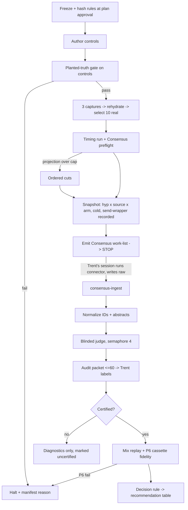

# feat: Literature-source comparison spike for discovery-pipeline grounding

**Target repo:** trentleslie/kraken-chatbot (branch `study/lit-source-comparison`). **PR base: `dev`** (repo convention: all PRs target `dev`; `main` is reached only through `promote/*` branches).

**Execution split (approved 2026-11-11):** the automated build implements and tests **Units 1-3 only**. Unit 4 needs Trent mid-run (Consensus connector calls in his interactive session, and audit labeling), so it is executed interactively after the build PR merges and is **out of scope for the build workflow**. The build must not run captures, live source calls, or judging beyond what unit tests need. KRAKEN is the knowledge graph; this concerns the KRAKEN chatbot's discovery pipeline, specifically its `literature_grounding` node.

## Overview

A one-time research spike that decides which literature sources the discovery pipeline should keep, add, fix the query for, reweight or drop, and whether a certified link-evidence filter should screen the papers users see. A small standalone harness under `backend/src/kestrel_backend/evals/lit_sources/`:

- captures real pipeline hypotheses;
- snapshots each source once (cold, every call recorded, including failures);
- normalizes papers to canonical IDs and abstracts;
- judges evidence on the specific link (blinded LLM judge, certified by Trent's audit);
- replays the production merge to measure what users actually see.

Production code is not changed.

## Problem Frame

On dev run `cdf9fa68`, all 30 kept papers came from OpenAlex and Exa; KG, PubMed and S2 contributed nothing. Nobody has measured whether kept papers are evidence for the hypotheses. The fix-first gate (G0) was lifted on 2026-11-11 (Trent): the spike runs now, S2 runs as a normal Tier 1 source if its new key (installed 2026-11-11) verifies at run time, otherwise `unavailable`, and Consensus joins through the claude.ai connector (see origin).

Research facts that shape the design:

1. **No stored real hypotheses.** Postgres keeps only the synthesis markdown, and Langfuse only counts. The two committed captures (`backend/assessment_data/assessment_runs/assessment_20260618T*.json`) hold 3 hypotheses on one urolithin query with an empty `study_context`, so they have no disease focus and are unusable here. Real hypotheses must be captured fresh.
2. **KG short-circuits the other sources.** In `literature_grounding.run()`, if `ground_hypothesis_kg` returns any PMID, `parallel_search_hypothesis` is skipped. KG PMIDs are attached per entity, not per link, at relevance 1.0.
3. **The merge compares relevance scores on different scales.** `merge_literature` sorts on raw `relevance_score` and keeps `papers_per_hypothesis = 3`:
   - KG: 1.0;
   - OpenAlex: 0.9 − 0.03·rank;
   - PubMed: 0.88 − 0.03·rank;
   - Exa: its native score;
   - S2: a Jaccard-based score that runs low.

   S2 therefore structurally loses the kept set. The production fetch is `parallel_fetch_limit = 6` per source, and dedup ties depend on concatenation order (OpenAlex, Exa, PubMed, S2).

## Requirements Trace

Carried from origin (R numbers as in the requirements doc):
- R1–R3, R2a (hit definition, blinded judge, audit certification, normalization) → Units 2, 3
- R4–R6a (real hypotheses, controls, pinned Hypothesis objects) → Unit 1
- R7, R7a, R8–R10, R13 (sources and tiers, error transparency, arms, top-k, ToS gate) → Units 2, 4
- R10a, R10b (end-to-end kept set, judge-as-filter) → Unit 3
- R11, R16 (diagnostics, decision rule) → Units 1 (frozen), 3 (applied)
- R14, R15, R17 (persistence, resume, budget) → Unit 1, Compute budget, Unit 4

## Scope Boundaries

- No change to `backend/src/kestrel_backend/graph/nodes/literature_grounding.py`, its clients or its config. The harness imports production functions (`build_search_query`, the `*_raw` source functions, `merge_literature`, `ground_hypothesis_kg`) and never patches their logic.
- Not a reusable benchmark: no CI job, no cron, no Inspect solver. Four modules and the tests the gates need, nothing more.
- Judging uses title and abstract only. Verdicts are hit/not-hit plus direction.

### Deferred to Separate Tasks

- The production PubMed fix (#126), S2 exponential backoff (promised on the key request form; due before the new key is used), the KG `direct_kg` `edge[5]` PMID extraction fix, any adopted mix/query/filter change, and per-source health logging. Each is its own PR, filed from this spike's findings.

## Context & Research

### Relevant Code and Patterns

- `backend/src/kestrel_backend/evals/biomapper_resolution/run_eval.py` + `backend/tests/test_biomapper_eval.py`: the eval shape to mirror. It always writes an artifact (`--out` is only an override) and pins its reproduce inputs.
- `backend/src/kestrel_backend/graph/runner.py:run_discovery` (takes `structured_analytes`). `assessment/capture.py` does not pass analytes, so the harness calls `run_discovery` directly.
- `backend/src/kestrel_backend/assessment/capture.py`: its `httpx.AsyncClient.send` patch pattern. `assessment/cassette.py` provides `CassetteRecorder`, `CassetteReplayer` and `setup_replay`, used for P6 replay.
- `backend/src/kestrel_backend/graph/nodes/literature_grounding.py`: the `*_raw` functions, `parallel_search_hypothesis`, `merge_literature`, `SOURCE_PRIORITY`, `collect_pmids_from_state`, `ground_hypothesis_kg` and `run`. The latter two use attribute access on state objects.
- `client/src/lib/analyteParse.ts` (the CSV analyte parser, which exists only in TypeScript) and `backend/src/kestrel_backend/analyte_ingest.py:validate_and_normalize`.
- `kestrel_client` `get_metagraph` MCP tool, for the KG fingerprint.
- Clients that turn errors into `[]`:
  - `openalex.search_works`: all errors.
  - `semantic_scholar.search_papers`: all except 429.
  - `exa_client`: no key, or a non-HTTP error.
  - `pubmed_client._esearch` / `_esummary`: generic exceptions.

  NCBI can also return HTTP 200 with an `ERROR` field.
- `load_dotenv()` must run before importing `kestrel_backend` (`EXA_API_KEY` and `S2_API_KEY` are read at import time). Tests: pytest `asyncio_mode = auto`, `respx` available, `ftfy` available, run with `python -m pytest`.

### Institutional Learnings

- **Batch-run discipline** (`docs/solutions/best-practices/reliable-long-running-llm-batch-runs-2026-06-07.md`): one transient-exception tuple; retry, then raise; per-item JSONL checkpoints; cost counted per unit.
- **Failed is not empty** (vault `absent-evidence-is-unverifiable-not-wrong-2026-08-06.md`): a failed call is never pooled as "nothing found".
- **No HTTP cache** (memory `project_tier3_determinism_cache_confound`): run cold.
- **Match on every identifier** (memory `project_hajjar_scorer_artifact`): not just the first.
- **Missing verdicts block** (vault `benchmark-gate-changes-to-llm-majority-vote-validation-gates-2026-11-01.md`): a missing verdict blocks rather than passing; calibrate against the human, not against LLM-to-LLM agreement.
- **Prove gates can fail** (vault `vacuous-tests-verify-the-mutation-landed-2026-08-04.md`).
- **Real fixtures** (vault `hand-built-fixture-hid-a-live-production-bug-2026-09-23.md`): captured real payloads, not hand-built ones.
- **Elicit access** (memories `reference_elicit_api`, `reference_ipv6_cloudflare_broken`): REST `/api/v2`, browser User-Agent, IPv4.
- **Artifacts outlive the worktree** (vault `expensive-run-artifacts-must-outlive-the-worktree-2026-08-04.md` + memory `reference_paperbanana_run_provenance`): manifest written at start; output outside the worktree.
- **Repair mojibake** (`docs/solutions/logic-errors/repair-dont-strip-utf8-mojibake-in-citation-fields-2026-06-01.md`): repair, don't strip, before dedup and judging.
- **Spike sizing** (memory `feedback_spike_sizing`): budget and fan-out set up front.

## Key Technical Decisions

- **One snapshot, many views.** Each (hypothesis, source, arm) is called once, cold, at production limits:
  - The Arm 1 `*_raw` functions run with `limit = parallel_fetch_limit` (6), and the resulting `LiteratureSupport` objects are persisted after the Exa filter and S2 scoring.
  - Precision@5 is a derived view over the first 5.
  - All mixes and diagnostics read this snapshot; nothing is re-queried per mix.
- **Error transparency via the harness's own `send` wrapper.** It patches `httpx.AsyncClient.send` (the `capture.py` pattern) and records, per call, request, status and body, or `{exception_type, url}` when the call raises.
  - **Recorder scope:** one recorder per (hypothesis, source, arm); interactions are attributed to a source by host.
  - **States** (the origin's `error` is named `lookup_failed` here; it means the same):
    - `unavailable`: key or connector absent.
    - `lookup_failed`: any recorded exception, any non-2xx response, a 2xx whose body contains a source error (NCBI `ERROR` / `WarningList`, OpenAlex or Exa error JSON), or no expected-host interaction while the key is present.
    - `empty`: 2xx with zero parsed items.
    - `ok`: otherwise.
- **Arm 1 PubMed is the production client by design** (as-deployed), so it is exposed to #126. The **client-failure attribution uses a matched pair:** the direct E-utilities client is also run with the identical Arm 1 sentence, and only that same-query pair can attribute a failure to the client. Arm 2 PubMed (Boolean query) separately tests query form. Certification: the direct client must return ≥1 PMID on a fixed known query at run start.
- **Consensus is a separately promoted candidate source** (neither Tier 1 nor Tier 2):
  - **Queries:** Consensus gets only its native question form. It is not part of the deployed pipeline, so it has no Arm 1.
  - **Collection:** an explicit stop point in the run. The harness emits `consensus_worklist.jsonl` and stops; the connector calls run in Trent's interactive Claude session (the claude.ai connector is not guaranteed to exist in dispatched or headless agents); the harness resumes on `consensus-ingest`.
  - **Records:** the agent writes the **raw connector output per call** (text or error, plus timestamp); the harness derives the call state from it.
  - **Preflight:** a connector probe in the timing stage. If the connector is unavailable, Consensus is `unavailable`, not `not_run`.
- **Replay fidelity is checked exactly, not against a live run.** P6 runs the real `literature_grounding.run()` on rehydrated state inside `setup_replay(snapshot_cassette)`, so drift is zero by construction.
  - **Pass condition:** kept sets must be identical.
  - **Halt conditions:** any unmatched request, or a `literature_errors` entry containing "grounding failed".
  - **Coverage:** at least 1 KG-path and 1 search-path hypothesis.
  - **Tie order:** replay preserves production concatenation order.
- **Captured state is rehydrated before use.** Captures serialize with `model_dump()`, but `collect_pmids_from_state` and `run()` use attribute access. Rehydration uses `model_validate` into `Finding`, `DiseaseAssociation`, `EntityResolution` and `Hypothesis`. Gate: the KG PMID count from rehydrated state equals the count from the live state at capture time. Otherwise the harness itself would fabricate the "KG yields 0" result.
- **Candidate mixes are pre-fixed, deliberately departing from origin R10a.** The origin said mixes are chosen from diagnostics; choosing after seeing data is the post-hoc choice pre-registration exists to prevent. The pre-fixed mixes, frozen in `decision_rule.json`:
  - **(a)** current mix with PubMed's Arm 2 Boolean query in place of the production query;
  - **(b)** current mix + Consensus;
  - **(c) reweight:** current sources with per-source rank-normalized scores (score = 1 − rank/limit per source, ties broken by `SOURCE_PRIORITY`).

  **Consensus score mapping in replay:** frozen to mirror OpenAlex (0.9 − 0.03·rank, priority just after OpenAlex). An "add" verdict must also hold under a best-case (1.0) and a worst-case (0.5) mapping.
  - **Elicit** (Tier 2): built only if its ToS gate is "yes" and the timing run shows headroom. It has source-level diagnostics only, labelled "no kept-set verdict".
- **Judge:**
  - **Model:** Claude Sonnet 5 via the Agent SDK on the local Claude login. It shares a family with the Opus hypothesis generator; this is disclosed, and certification rests on Trent's audit.
  - **Inputs:** claim, title and normalized abstract only, blind to source.
  - **Concurrency:** fixed by design at a semaphore of 4.
  - **Missing verdicts:** a missing or unparseable verdict is `not_run`. Any `not_run` blocks verdicts, not diagnostics.
- **Audit:**
  - **Sample rule:** written into `decision_rule.json` at the freeze. The sample is drawn after judging by a seeded rule, stratified by source × judge verdict, with **verdicts hidden from Trent**.
  - **Packet size (hard cap):** 40 sampled rows + all false-support events, deduplicated by (hypothesis, paper) and capped at 15, + 5 resolved-Consensus identity checks. That is ≤ 60 readings, about 1 hour.
  - **Certification:** pooled agreement ≥ 85% **and** κ ≥ 0.6 **and** judge PPV ≥ 0.75.
  - **Per-source agreement:** reported with n, descriptive only (cells are too small to exclude a source on).
  - **Headline precision:** reported raw **and** PPV/NPV-corrected to the population verdict prevalence.
  - **Non-certification** blocks verdicts, not the run (origin R3). The output is diagnostics marked uncertified plus ID-matched landmark recall.
- **Headline population:** the 10 real hypotheses only. Controls feed P1–P3 and never enter headline metrics or decision-rule inputs (enforced by a test). The count of KG-short-circuited real hypotheses is reported. Comparative verdicts are computed on the **search-path subset**, and marked underpowered if that subset has fewer than 6 hypotheses.
- **Decision rule** (frozen and hashed in `rules/decision_rule.json` at plan approval; any later change is logged as a deviation in the manifest):
  - **Precedence:** PubMed client-failure diagnosis, then fix query, then add, then reweight, then drop, then keep. "Drop" is blocked for any source diagnosed `client failure`.
  - **Drop:**
    - zero judged hits in every kept set across all mixes; **and**
    - Wilson 95% upper bound on pooled per-source precision < 0.2; **and**
    - ≥ 30 judged papers with abstracts.

    Otherwise the result is "insufficient data".
  - **Fix query:** Arm 2 precision exceeds Arm 1, with a bootstrap 95% CI over hypotheses excluding 0, **and** Arm 2 precision ≥ 0.2. Yield is reported, not decisive.
  - **Add (Consensus):**
    - ToS gate "yes"; **and**
    - judged unique kept hits spread over ≥ 3 distinct real hypotheses; **and**
    - no increase in false-support count; **and**
    - holds under both best-case and worst-case score mappings.
  - **Reweight:** mix (c) raises kept-set precision, with a CI excluding 0.
  - **Judge filter:** raises kept-set precision **and** lowers false-support, with a CI excluding 0.
  - **Keep:** any difference whose interval includes 0 maps to keep-as-is.
  - **Unavailable:** a source that did not run (S2 today) appears in the table as `unavailable` with its reason.
- **Run directory:** `~/kraken-studies/lit-sources/<UTC-ts>/`, on local disk outside the Drive checkout and the worktree. The manifest is written at start and updated per stage, recording:
  - repo SHA;
  - rule and CSV hashes;
  - judge model and prompt hash;
  - KG fingerprint from `get_metagraph`, via the same `KESTREL_MCP_URL` as capture (URL logged);
  - per-source status;
  - per-call timestamps;
  - `cache: cold`;
  - "G0 lifted";
  - budget counters;
  - deviations.

  Per-item JSONL checkpoints enable resume.

## Open Questions

### Resolved During Planning

- **Hypothesis source:** 3 fresh `run_discovery` captures with fixed query strings (written in `rules/capture.json` at the freeze). The capture runs use:
  - the T2D modules panel, with its module directions;
  - the T2D basic panel;
  - one non-diabetes free-text query (Alzheimer's disease).

  The panel CSVs are copied into `evals/lit_sources/rules/` and hashed. A Python parser mirrors `analyteParse.ts` and is validated by `analyte_ingest.validate_and_normalize`.
- **Selection:**
  - **Order:** round-robin across the 3 runs, in production tier order, deduplicated, until 10.
  - **Coverage check:** ≥ 2 panels and both bridge and inferred-role types; continue the round-robin if not met.
  - **Fallback:** if fewer than 10 exist, use ≥ 6. If fewer than 6, capture one more run.
- **Survivorship:** none. No stage filters hypotheses using grounding output.
- **KG standalone:** `collect_pmids_from_state` + `ground_hypothesis_kg` on rehydrated captured state. KG has no Arm 2 and is excluded from drop and reweight verdicts.
- **Precision with fewer than 5 results:** hits ÷ returned papers that have abstracts, with the returned count shown.
- **False support:** reported as raw counts. Origin R6 supersedes R11's "rate".

### Deferred to Implementation

- Consensus free-plan quota (measured at preflight; if it binds, reduce Consensus to real hypotheses only).
- Elicit cost and ToS answer.
- Consensus title-resolution quality (thresholds below; unresolved share reported).

## Output Structure

    backend/src/kestrel_backend/evals/lit_sources/
        __init__.py
        run_study.py        # stages, manifest, resume, capture, selection, controls loader
        sources.py          # send wrapper, call states, Arm 1/2 adapters, Consensus work-list/ingest, normalization
        judge.py            # blinded judge, audit packet export/ingest, agreement + PPV correction
        analyze.py          # rehydration, mix replay, P6 fidelity, diagnostics, decision rule, report
        rules/              # frozen + hashed: query_rules.json, decision_rule.json, capture.json, panel CSVs
        controls/           # true_links.json, false_links.json (authored after the freeze)
    backend/tests/
        test_lit_sources.py
        fixtures/lit_sources/   # captured real payloads incl. failure cases

## High-Level Technical Design

> *This illustrates the intended approach and is directional guidance for review, not implementation specification. The implementing agent should treat it as context, not code to reproduce.*

## Planted-truth controls

All controls are authored after the rule freeze and before any real hypothesis is queried. They go through the full path: the same adapters, normalization, judge and matcher as real hypotheses. P1–P3 and P6 run live; P4 and P5 are unit tests over captured real payloads (the live data contains no deliberately broken inputs to catch).

| Control | Planted | Pass criterion | On failure |
|---|---|---|---|
| **P1 Known-true recall** | ~6 established links, each with ≥1 landmark registered as a PMID + DOI pair verified in PubMed at authoring. ≥2 of the links are of moderate obscurity. | ≥1 landmark recovered by canonical-ID match overall. Each available source with zero landmark recall gets a written disposition (broken vs genuine corpus gap), and its verdict is marked low-confidence. | Zero overall → halt. |
| **P2 Near-miss corruption** | One true link with **one** entity swapped for a sibling (keep A, replace B with a related B′). Its original landmark is injected into the corrupted hypothesis's paper list. | Judge marks the injected landmark not-hit for the corrupted link and hit for the clean twin, **consistently across 3 live runs**. | Halt: the judge is matching topic, not link. |
| **P3 False links** | ~4 fabricated plausible links, each with a recorded pre-run search across all sources showing no supporting literature. | Every judge "supports" verdict goes to Trent's audit (within the packet cap). Counts are reported raw. | Not a halt; this is the measured quantity. |
| **P4 Matcher mutation** (unit test) | A landmark as DOI-only, PMID-only and mojibake'd title; a decoy DOI with one character changed. | The 3 variants match; the decoy does not. | Test fails → the build halts. |
| **P5 Failure states** (unit test) | Captured: S2 403; OpenAlex 500; a raised timeout (no response); NCBI 200 with `ERROR`; a genuine empty 200; Exa with no key. | `lookup_failed` ×4, `empty`, `unavailable`. | Test fails → the build halts. |
| **P6 Replay fidelity** | `run()` on rehydrated state inside `setup_replay(snapshot_cassette)`, ≥1 KG-path and ≥1 search-path hypothesis. | Identical kept sets; no unmatched request; no "grounding failed". | Halt: the headline would measure the harness. |

Direction-reversed twins are deliberately **not** used: under R1, refuting evidence is a hit, so a reversed link has no clean expected answer.

## Compute budget

- **Caps:**
  - **Metered spend:** $25. The origin's "$25 of LLM judging + credits" is redefined to metered spend, because judging and capture run on the local Claude login with no metered cost. Metered spend is Exa calls plus Elicit credits if Tier 2 runs.
  - **Trent's time:** about 1 hour (the audit packet cap).
  - **Wall-clock:** 2 hours for the post-capture run (timing-discipline threshold). The three captures (multi-minute Opus runs) are timed and reported separately.
- **Timing run first:** 1 real hypothesis × all available sources × arms, plus judging of its papers, plus the Consensus preflight, with a time-stamped log. Rate fit per stage, and the projection is written to the manifest with its provenance before the full run.
- **A priori fan-out (an unmeasured guess the timing run replaces):**
  - 21 hypotheses (10 real + 6 true + 4 false + 1 corruption twin).
  - About 170 source calls: Tier 1 Arm 1 (OpenAlex, Exa, PubMed; S2 unavailable today), Arm 2 PubMed Boolean, the matched PubMed direct call, and Consensus questions.
  - Up to ~1,000 raw papers, about 600–800 judge calls.
  - At semaphore 4 and roughly 5–15 s per call: about 15–50 minutes of judging.
- **Ordered cuts if a projection exceeds a cap** (origin R17 extended; the added steps are deliberate):
  1. drop Tier 2 (Elicit);
  2. limit Consensus to real hypotheses only;
  3. drop Arm 2 for sources whose native form is the sentence;
  4. trim real hypotheses from 10 to 6.
- **Progress unit:** judged rows in `judgments.jsonl`.

## Independence

| Headline number | Produced by | Certified by | Why they can't fail the same way | Deepest shared layer |
|---|---|---|---|---|
| Kept-set evidence precision per mix (real hypotheses) | Blinded LLM judge on replayed kept sets | Trent's audit (verdict-blind), PPV/NPV correction | Human vs LLM reader. The sample rule was frozen before verdicts existed, and Trent never sees the verdict. | The same normalized abstract. Mitigated by ftfy repair; no-abstract papers are excluded and counted. |
| False-support count | Judge "supports" on fabricated links | Trent reviews every event (≤ 15 after dedup) | Full review, not a sample | The fabricated links. Mitigated by the recorded pre-run search, but that search uses the same sources under test, so "false" means "absent from these sources" (disclosed). |
| Landmark recall | Canonical-ID matcher | Pre-registered landmark list + P4 mutation test | The list is fixed before any query, and the matcher is proven to fail on the decoy. | NCBI ID converter / OpenAlex. Landmarks are verified directly in PubMed at authoring. |
| "Current mix = production" | Harness replay | P6: the real `run()` under cassette replay | Production entry point vs harness path, on identical inputs | `merge_literature` (shared by design; the claim is fidelity, not merge correctness). |
| PubMed client vs query vs corpus | Pipeline client vs direct client | The matched same-query pair + a known-count certification query | Different code paths, same query | NCBI (the ground truth). |

Edits to controls or rules after the first real query are logged as deviations in the manifest.

## Implementation Units

- [x] **Unit 1: Run harness: manifest, rules, capture, selection, controls**

**Goal:**
- Freeze and hash `rules/` (`query_rules.json`, `decision_rule.json`, `capture.json`, panel CSVs).
- Load the controls.
- Run the 3 captures via `run_discovery`, rehydrate state, select 10 real hypotheses, and serialize every hypothesis as `Hypothesis` + `disease_context` + entity-name map.
- Provide stages, manifest at start, per-item resume, and the transient-retry policy.

**Requirements:** R4–R6a, R14, R15, R16 (freeze), R17

**Dependencies:** None

**Files:**
- Create: `backend/src/kestrel_backend/evals/lit_sources/__init__.py`, `backend/src/kestrel_backend/evals/lit_sources/run_study.py`, `backend/src/kestrel_backend/evals/lit_sources/rules/*`, `backend/src/kestrel_backend/evals/lit_sources/controls/*`
- Test: `backend/tests/test_lit_sources.py`

**Approach:**
- Mirror `run_eval.py`. Call `load_dotenv()` before imports.
- The panel CSV parser mirrors `client/src/lib/analyteParse.ts`.
- Rehydrate captured state with `model_validate`. Gate: KG PMID count from rehydrated state equals the live count at capture.

**Test scenarios:**
- Happy path: manifest written before any stage runs; a killed run resumes to the same row count.
- Error path: a rule-file hash mismatch at query time → the stage refuses to run.
- Error path: an injected timeout is retried, then raises; it is never written as a result.
- Edge case: selection round-robin hits the coverage check (≥ 2 panels, both types); fewer than 10 falls back to ≥ 6.
- Integration: rehydrated state yields the same KG PMIDs as typed state; a plain-dict state yields 0 (proves the gate can fail).
- Integration: the parsed modules CSV passes `validate_and_normalize` and reproduces the module directions.

**Verification:** captures persisted, 10 selected hypotheses serialized, KG-count gate passes, manifest carries all hashes.

- [x] **Unit 2: Sources, call states and normalization**

**Goal:**
- The send wrapper and call-state classifier.
- Arm 1 production `*_raw` calls at production limits.
- Arm 2 PubMed (Boolean) plus the matched same-query direct call.
- Consensus work-list emit and ingest (raw output in, state derived).
- Elicit adapter, built only if its ToS gate passes and the budget has headroom.
- Normalization:
  - canonical IDs, matching on every identifier;
  - one abstract-resolver chain: PMID → EFetch, DOI → OpenAlex `abstract_inverted_index`, title → OpenAlex;
  - ftfy repair;
  - Consensus title resolution with similarity ≥ 0.9, plus a year and first-author check;
  - unresolved and no-abstract shares reported per source.

**Requirements:** R2a, R7, R7a, R8, R9, R13

**Dependencies:** Unit 1

**Files:**
- Create: `backend/src/kestrel_backend/evals/lit_sources/sources.py`
- Test: `backend/tests/test_lit_sources.py`, `backend/tests/fixtures/lit_sources/` (captured real payloads)

**Test scenarios:**
- P5: each failure fixture classifies as specified; Exa without a key → `unavailable`; a raised timeout (no response) → `lookup_failed`.
- P4: DOI-only, PMID-only and mojibake'd landmark variants match; the one-character decoy does not.
- Integration: Arm 1 OpenAlex receives exactly the query string `build_search_query` produces for the same hypothesis; snapshot holds 6 per source.
- Integration: the matched pair runs the direct client on the identical Arm 1 sentence.
- Edge case: a Consensus title with near-match but wrong year stays unresolved, not mis-resolved.
- Error path: a missing work-list row is `not_run`; a recorded connector error is `lookup_failed`; a failed preflight makes Consensus `unavailable`.

**Verification:** every call in the snapshot has exactly one state; no exception yields `ok` with 0 hits.

- [x] **Unit 3: Judge, audit, replay, analysis**

**Goal:**
- Blinded judging (semaphore 4).
- Audit packet export and ingest under the hard cap, with agreement, κ, PPV/NPV and corrected precision.
- Mix replay (current, a, b, c) with the KG-first short-circuit, plus P6 cassette fidelity.
- The judge-filter variant.
- Diagnostics: precision@5 with n, unique hits, landmark recall, false-support counts, median latency, call-state counts, cost.
- The KG-path count and search-path-subset comparisons.
- The decision rule with precedence; the recommendation table; the PubMed three-way diagnosis; the KG zero-yield evidence.

**Requirements:** R1–R3, R10a, R10b, R11, R16, Success Criteria

**Dependencies:** Unit 2

**Files:**
- Create: `backend/src/kestrel_backend/evals/lit_sources/judge.py`, `backend/src/kestrel_backend/evals/lit_sources/analyze.py`
- Test: `backend/tests/test_lit_sources.py`

**Test scenarios:**
- Happy path: on a synthetic snapshot with a planted known precision, that value is recovered exactly.
- Integration (P6): replay equals the real `run()` under cassette replay; a mutated replay is detected and halts.
- Edge case: duplicates across sources keep the higher `SOURCE_PRIORITY` copy, and tie order matches production concatenation.
- Edge case: control hypothesis IDs never appear in the headline frame.
- Edge case: a source with 0 hits and fewer than 30 judged papers → "insufficient data", not "drop".
- Edge case: PubMed diagnosed `client failure` → drop blocked; precedence picks client failure.
- Edge case: a Consensus "add" that fails under the worst-case score mapping → not added.
- Error path: any `not_run` judgment, or a non-certified judge → no verdicts, diagnostics marked uncertified.
- Integration (P2, live, recorded): the near-miss twin is judged not-hit and the clean twin hit, 3 of 3.

**Verification:** the recommendation table has a verdict or `unavailable` per Tier 1 source, a verdict for Consensus, and a judge-filter yes/no, each traceable to run-directory files.

- [ ] **Unit 4: Execute: gate, captures, timing, snapshot, Consensus stop, judge, audit, analysis** *(interactive, after the build PR; not part of the automated build)*

**Goal:** Run the stages in order.
1. Planted-truth gate (P1, P2, P3 setup).
2. Captures.
3. Timing run with Consensus preflight, and the projection written down.
4. Cuts if any cap would be exceeded.
5. Snapshot.
6. **Stop** for Consensus collection in Trent's session; then ingest.
7. Normalize and judge.
8. Audit packet → Trent → ingest.
9. P6, mixes and analysis.

The report goes to the wiki through the pipeline's publish stage.

**Requirements:** all

**Dependencies:** Units 1–3

**Files:** run directory only (outside the repo)

**Test expectation:** none. This unit executes tested code; the gates are the checks.

**Verification:**
- The manifest shows every stage complete, all gates passed, judge certification recorded, metered spend ≤ $25, and audit packet ≤ 60 readings.
- Every reported number cites its run-directory file.

## System-Wide Impact

- **Read-only use of production code.** Captures run the full discovery pipeline locally (local Claude login; Kestrel at the logged `KESTREL_MCP_URL`).
- **Error propagation:** every external failure becomes a recorded call state.
- **Unchanged invariants:** the production node, clients, config and deployments.
- **External load:** about 170 source calls; Exa and NCBI within their key limits; Consensus within the free-plan allowance, measured at preflight.

## Risks & Dependencies

| Risk | Mitigation |
|------|------------|
| Consensus connector absent or quota-limited | Preflight probe; `unavailable` fallback; cut step 2 |
| Judge not certified | Diagnostics plus ID-matched landmark recall, marked uncertified; no verdicts (origin R3) |
| P6 replay mismatch | Halt before any headline number exists |
| Small n / KG short-circuit dilutes comparisons | Search-path subset; marked underpowered below 6; Wilson bounds and minimum-n for drop |
| T2D-heavy set | Third capture is non-diabetes by rule; generalization stated as a limitation |
| Same model family for judge and generator | Disclosed; certification by Trent, PPV-gated |
| S2 key still rejected | `unavailable` with reason; S2 cells can be added later under the same frozen rules |
| Snapshot calls lack production's overall 300 s timeout | Per-call latency recorded; any source exceeding 300 s per hypothesis is flagged as "production would have timed out" |

## Documentation / Operational Notes

- The final report publishes to the Phenome wiki through the research tail, citing the run directory and manifest. Follow-up issues: #126 production fix, S2 backoff, KG `edge[5]` extraction, and any adopted change.

## Sources & References

- **Origin document:** [docs/brainstorms/2026-11-11-literature-source-comparison-requirements.md](../brainstorms/2026-11-11-literature-source-comparison-requirements.md)
- Related code: `backend/src/kestrel_backend/graph/nodes/literature_grounding.py`, `backend/src/kestrel_backend/assessment/cassette.py`, `backend/src/kestrel_backend/assessment/capture.py`, `backend/src/kestrel_backend/evals/biomapper_resolution/run_eval.py`
- Related issues: #124/#125 (fixed, PR #130), #126
- Prior art: `docs/plans/2026-05-29-001-feat-astabench-litground-comparison-plan.md`
